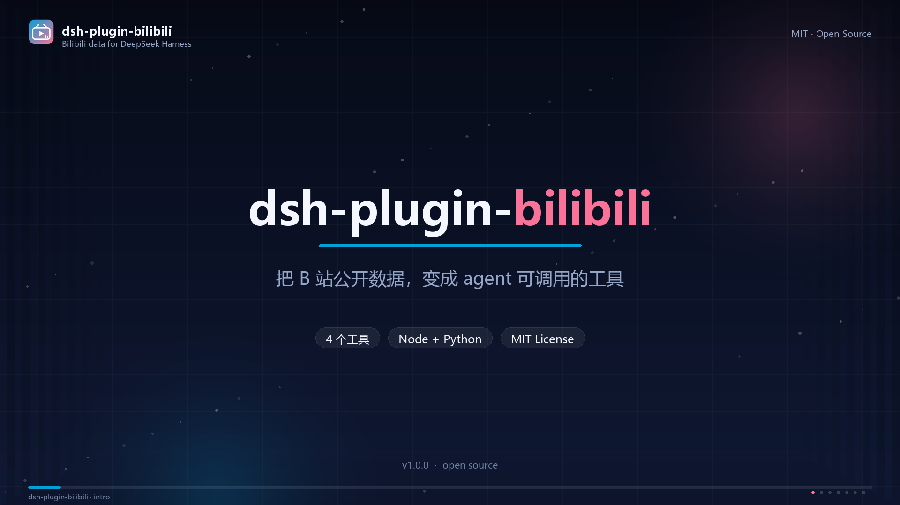
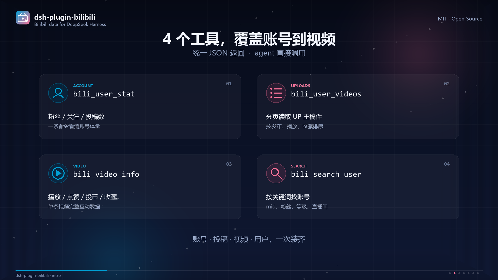
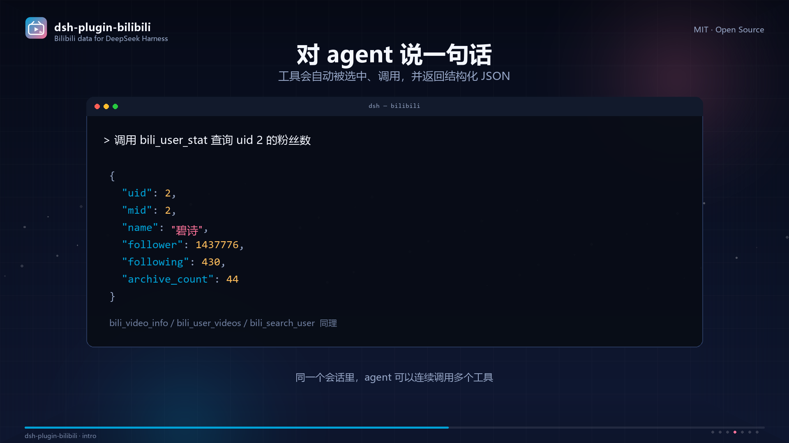
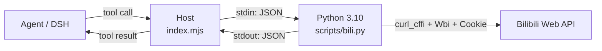

# dsh-plugin-bilibili

> 中文介绍见下方：[中文说明](#中文说明)。

[English](#english) · [中文](#中文说明)

<p align="center">
  
</p>

<p align="center">
  <a href="docs/usage.md">Usage</a> ·
  <a href="docs/install.md">Install</a> ·
  <a href="LICENSE">MIT License</a>
</p>

`dsh-plugin-bilibili` is a DeepSeek Harness (DSH) bundle that gives an agent four Bilibili public-data tools. The Node host registers the tools and spawns a Python 3.10 data layer; every HTTP request is made there and returns structured JSON.

## English

### Overview

The plugin exposes four tools:

| Tool | Purpose | Main fields |
|---|---|---|
| `bili_user_stat` | Account overview | nickname, followers, following, upload count |
| `bili_user_videos` | Paginated upload list | bvid, title, duration, publish time, views, comments, danmaku |
| `bili_video_info` | Single-video stats | views, likes, coins, favorites, shares, danmaku, replies, duration, owner |
| `bili_search_user` | Keyword user search | mid, nickname, signature, followers, uploads, level, live room |

All tools query **public data only**. No private messages, favorites, watch history, or other login-only data.

### Preview

| Tools | Terminal |
|---|---|
|  |  |

### Architecture



- The **host** only registers `defineTool`, probes Python, spawns the child process, and parses stdout JSON.
- The **Python layer** owns every HTTP request: `curl_cffi` for TLS impersonation, Wbi signing for risk control, `.env` for the cookie.
- Arguments travel over **stdin JSON**, never a command line. stdout contains one final JSON line; logs go to stderr.

### Requirements

- DSH 0.2.x (developed and verified with `0.2.1-rc.5`)
- Node.js >= 20 (the bundled runtime here is 24.x)
- Python **3.10.11** (3.10-compatible syntax only)
- Python packages: `curl_cffi`, `python-dotenv`

```bash
python -m pip install -r scripts/requirements.txt
```

If `python` is not on PATH, set `BILI_PYTHON` to the interpreter path.

### Quick start

#### 1. Configure the cookie

```bash
cp .env.example .env
```

```dotenv
BILI_COOKIE="SESSDATA=YOUR_SESSDATA; bili_jct=YOUR_BILI_JCT; buvid3=YOUR_BUVID3"
```

- `.env` must live in the plugin root. Python resolves it from `Path(__file__)` rather than the current working directory.
- Environment variables take precedence over `.env`.
- An anonymous cookie (`buvid3` + `b_nut`) is enough for public data; an account `SESSDATA` is more stable for upload lists.

#### 2. Install into a DSH profile

Ask the agent to call `plugin_manager`:

```json
{
  "action": "install_bundle",
  "target": "/absolute/path/to/dsh-plugin-bilibili"
}
```

Or use the CLI:

```bash
dsh plugin --profile <profile> add /absolute/path/to/dsh-plugin-bilibili
```

Then add `dsh-plugin-bilibili` to `dsh.profile.bundles` in the profile `package.json` and restart DSH.

For a temporary test without installing:

```bash
dsh --profile headless --patch ./cordis.yml "call bili_user_stat for uid 2"
```

`cordis.yml` uses `name: './index.mjs'`, so it does not need to be installed first.

> Non-ASCII paths: pnpm on some Windows setups corrupts `link:` paths containing non-ASCII characters. If the installed path looks garbled, move the plugin to an ASCII-only directory first.

#### 3. Call the tools

In the Web GUI, just ask:

```text
Call bili_user_stat for uid 2.
Call bili_video_info for bvid BV1GJ411x7h7.
Call bili_user_videos for uid 2, page 1, order pubdate.
Call bili_search_user with keyword "老番茄".
```

Example result:

```json
{
  "uid": 2,
  "mid": 2,
  "name": "碧诗",
  "follower": 1437776,
  "following": 430,
  "archive_count": 44
}
```

See [docs/usage.md](docs/usage.md) for every parameter, return field, and task template.

### Error codes

The Python layer prints `{"code": 0, "data": ...}` or `{"code": <code>, "message": "..."}`. The host turns any non-zero code into a readable tool error.

| code | Meaning | Handling |
|---|---|---|
| `0` | Success | — |
| `-1` | Local config / argument / network error | Read the message |
| `-101` | Not logged in | Cookie lacks a valid `SESSDATA` |
| `-352` | Wbi signature or cookie rejected (`风控校验失败`) | Refresh Wbi and retry twice; replace the cookie if it persists |
| `412` | TLS fingerprint / referer risk control | Retry twice; replace the cookie or wait |
| `-799` | Rate limited | Wait 10 seconds and retry once |
| `-404` | Resource not found | Check uid / bvid |
| other | Bilibili business error | Pass through the Bilibili message |

### Reliability

- `curl_cffi` browser impersonation, falling back `chrome131 → chrome124 → chrome116`.
- Wbi keys come from `x/web-interface/nav` and are cached for 24 hours.
- A global 2-second request interval (QPS <= 0.5); the host also serializes all tool calls.
- The upload-list endpoint uses the space page as `Referer`, which is more stable than the www homepage.
- Signed endpoints retry `412` / `-352` with bounded backoff.

### Security

- `.env` is git-ignored; only `.env.example` is committed.
- The cookie only appears in request headers. Logs print the item count and whether `SESSDATA` / `buvid3` exists, never the value.
- Arguments are passed over stdin, never interpolated into a command line.
- The child process removes `PYTHONUTF8` so `curl_cffi` can open non-ASCII CA paths without `curl(77)`.

See [SECURITY.md](SECURITY.md).

### Development

```bash
node --check index.mjs
python -m py_compile scripts/bili.py
```

```text
dsh-plugin-bilibili/
├── index.mjs              # DSH host: defineTool x4, spawn Python
├── client/index.mjs       # no UI, placeholder
├── scripts/bili.py        # Python 3.10 data layer
├── scripts/requirements.txt
├── cordis.patch.yml       # bundle manifest patch
├── cordis.yml             # quick --patch test
├── docs/                  # usage / install / architecture
├── assets/                # intro video, cover, screenshots, 180px icon
├── locale/                # plugin manager display name / description
├── icon.svg
├── .env.example
├── NOTICE.md
└── LICENSE
```

Design notes: [docs/architecture.md](docs/architecture.md). Contributing: [CONTRIBUTING.md](CONTRIBUTING.md).

### Compatibility

- Fully verified on Windows 10/11 + Python 3.10.11 + DSH 0.2.1-rc.5.
- macOS / Linux should work in theory (Node + Python), but are not end-to-end verified.
- Bilibili APIs and risk control change; issues and PRs are welcome.

### Attribution

- **Human developer**: a middle school student — project initiator, requirements, testing, release.
- **AI collaborator**: DeepSeek-V4.1-Flash — code, documentation, tests, and the intro video.
- DeepSeek-V4.1-Flash is a model name, not a legal person. Copyright is held by the human contributor(s); see [NOTICE.md](NOTICE.md).

### Disclaimer

This is an unofficial project. It is not affiliated with or endorsed by Bilibili or DeepSeek. Use it for learning and personal data queries only; follow Bilibili's terms of service, keep request rates low, and do not use it for bulk scraping or commercial purposes.

---

## 中文说明

> 把 B 站公开数据变成 DeepSeek Harness（DSH）agent 可以直接调用的 4 个工具。
>
> 由一名初中生与 DeepSeek-V4.1-Flash 联合开发（AI 协作）。

`dsh-plugin-bilibili` 是一个 DSH bundle：Node 宿主端向 agent 注册工具，Python 3.10 数据层负责所有 B 站 HTTP 请求。查询粉丝数、投稿列表、单视频互动数据和用户搜索，返回结构化 JSON。

### 视频

- **B 站**：[dsh-plugin-bilibili 介绍视频](https://www.bilibili.com/video/BV1yBsE6xE3A/)

### 功能

| 工具 | 作用 | 主要返回 |
|---|---|---|
| `bili_user_stat` | 账号概览 | 昵称、粉丝数、关注数、投稿数 |
| `bili_user_videos` | UP 主投稿列表（分页） | bvid、标题、时长、发布时间、播放、评论、弹幕 |
| `bili_video_info` | 单视频详情 | 播放、点赞、投币、收藏、分享、弹幕、评论、时长、UP 主 |
| `bili_search_user` | 按关键词搜用户 | mid、昵称、签名、粉丝、投稿数、等级、直播间 |

所有工具只查询**公开数据**，不读取私信、收藏夹、观看历史等登录态隐私内容。

### 架构


- **宿主端**只做四件事：注册 `defineTool`、探测 Python、`spawn` 子进程、解析 stdout JSON。
- **Python 层**负责所有 HTTP：`curl_cffi` 处理 TLS 指纹，Wbi 签名通过风控，`.env` 读 Cookie。
- 参数走 **stdin JSON**，不拼命令行；stdout 只有一行最终 JSON，日志全部走 stderr。

### 环境要求

- DSH 0.2.x（开发和验证使用 `0.2.1-rc.5`）
- Node.js >= 20（宿主端运行时为 24.x）
- Python **3.10.11**（只使用 3.10 兼容语法）
- Python 依赖：`curl_cffi`、`python-dotenv`

```bash
python -m pip install -r scripts/requirements.txt
```

如果 `python` 不在 PATH，可设置环境变量 `BILI_PYTHON` 指向 `python.exe`。

### 快速开始

#### 1. 配置 Cookie

```bash
cp .env.example .env
```

```dotenv
BILI_COOKIE="SESSDATA=YOUR_SESSDATA; bili_jct=YOUR_BILI_JCT; buvid3=YOUR_BUVID3"
```

- `.env` 必须放在插件根目录；Python 用 `Path(__file__)` 反查，不依赖 cwd。
- 环境变量优先于 `.env`。
- 匿名 Cookie（`buvid3` + `b_nut`）可以查公开数据；投稿列表建议使用自己账号的 `SESSDATA`，稳定性更好。

#### 2. 安装进 DSH profile

在 DSH 会话里让 agent 调用 `plugin_manager`：

```json
{
  "action": "install_bundle",
  "target": "/absolute/path/to/dsh-plugin-bilibili"
}
```

或使用 CLI：

```bash
dsh plugin --profile <profile> add /absolute/path/to/dsh-plugin-bilibili
```

然后把 `dsh-plugin-bilibili` 加进 profile `package.json` 的 `dsh.profile.bundles`，重启 DSH。

临时验证不需要安装：

```bash
dsh --profile headless --patch ./cordis.yml "调用 bili_user_stat 查询 uid 2 的粉丝数"
```

`cordis.yml` 里的 `name: './index.mjs'` 相对于 patch 文件定位。

> 非 ASCII 路径提示：pnpm 在部分 Windows 环境会把含中文的 `link:` 路径写坏。如果安装后 profile 里出现乱码路径，可先把插件放到纯 ASCII 目录，再安装。

#### 3. 调用

在 Web GUI 里直接说：

```text
调用 bili_user_stat 查询 uid 2 的粉丝数
调用 bili_video_info 查询 bvid BV1GJ411x7h7 的播放量
调用 bili_user_videos 查询 uid 2 的第一页投稿，按 pubdate 排序
调用 bili_search_user 搜索关键词「老番茄」
```

工具返回示例：

```json
{
  "uid": 2,
  "mid": 2,
  "name": "碧诗",
  "follower": 1437776,
  "following": 430,
  "archive_count": 44
}
```

完整参数、返回字段和任务模板见 [docs/usage.md](docs/usage.md)。

### 错误码

Python 层统一输出 `{"code": 0, "data": ...}` 或 `{"code": <code>, "message": "..."}`；宿主端把非 0 转成 agent 可读的工具错误。

| code | 含义 | 处理 |
|---|---|---|
| `0` | 成功 | — |
| `-1` | 本地配置/参数/网络错误 | 看 message |
| `-101` | 账号未登录 | Cookie 缺少有效 `SESSDATA` |
| `-352` | Wbi 签名或 Cookie 失效（`风控校验失败`） | 刷新 Wbi 自动重试 2 次；仍失败就换 Cookie |
| `412` | TLS 指纹 / 来源页风控 | 自动重试 2 次；仍失败就换 Cookie 或稍后再试 |
| `-799` | 请求频率过高 | 等待 10 秒重试一次 |
| `-404` | 资源不存在 | 检查 uid / bvid |
| 其他 | B 站业务错误 | 透传 B 站 message |

### 风控与稳定性

- `curl_cffi` 浏览器指纹（`chrome131 → chrome124 → chrome116` 降级）。
- Wbi 签名密钥从 `x/web-interface/nav` 获取，进程内缓存 24 小时。
- 请求间隔 ≥ 2 秒（QPS ≤ 0.5），宿主端再把所有工具调用串行化。
- 空间投稿接口使用空间页 `Referer`，比 www 首页更稳定。
- 签名接口的 `412` / `-352` 做有限退避重试。

### 安全

- `.env` 已被 `.gitignore` 忽略；仓库里只有 `.env.example` 占位值。
- Cookie 只出现在请求头；日志只输出 Cookie 项数和是否存在 `SESSDATA` / `buvid3`。
- 参数通过 stdin 传递，不拼接命令行。
- 子进程会删除 `PYTHONUTF8`，避免 `curl_cffi` 打开非 ASCII 路径的 CA 文件时报 `curl(77)`。

详见 [SECURITY.md](SECURITY.md)。

### 开发

```bash
node --check index.mjs
python -m py_compile scripts/bili.py
```

目录：

```text
dsh-plugin-bilibili/
├── index.mjs              # DSH 宿主端：defineTool ×4、spawn Python
├── client/index.mjs       # 本插件无 UI，占位
├── scripts/bili.py        # Python 3.10 数据层
├── scripts/requirements.txt
├── cordis.patch.yml       # bundle 正式装载
├── cordis.yml             # --patch 快速验证
├── docs/                  # usage / install / architecture
├── assets/                # 介绍视频、封面、截图、180px 图标
├── locale/                # 插件管理页显示名/描述
├── icon.svg
├── .env.example
├── NOTICE.md
└── LICENSE
```

设计说明见 [docs/architecture.md](docs/architecture.md)。贡献指南见 [CONTRIBUTING.md](CONTRIBUTING.md)。

### 兼容性

- 在 Windows 10/11 + Python 3.10.11 + DSH 0.2.1-rc.5 上完整验证。
- macOS / Linux 理论上可用（Node + Python 跨平台），但未做端到端验证。
- B 站接口和风控会变化；如果接口失效，欢迎 issue / PR。

### 致谢

- **人类开发者**：一名初中生（项目发起、需求、测试与发布）
- **AI 协作**：DeepSeek-V4.1-Flash（代码、文档、测试与视频制作）
- DeepSeek-V4.1-Flash 是模型名称，不是法律主体；本仓库的版权由人类贡献者持有，详见 [NOTICE.md](NOTICE.md)。

### 免责声明

本项目与哔哩哔哩（Bilibili）、DeepSeek 官方均无关，仅用于学习与个人数据查询。请遵守 B 站服务条款，控制请求频率，不要用于批量抓取或商业用途。

## License

[MIT](LICENSE) © 2026 dsh-plugin-bilibili contributors
