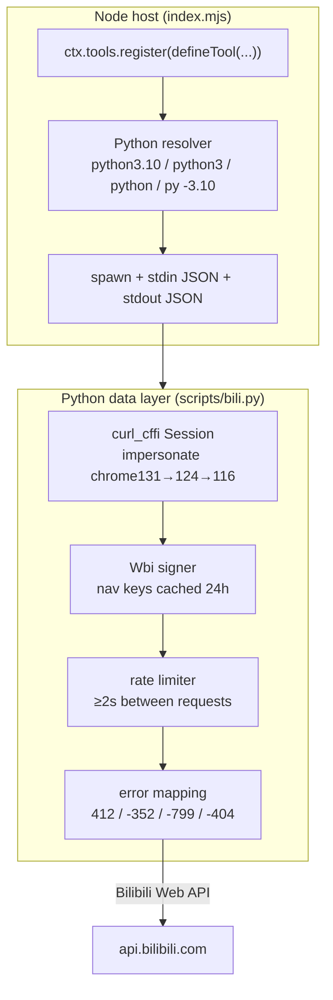

# 架构与实现

## 1. 目标

在 DeepSeek Harness（DSH）里提供一组 B 站数据工具，要求：

- agent 能像调用普通函数一样调用；
- 返回结构化 JSON，字段稳定；
- B 站请求全部集中在 Python 层，便于处理 TLS 指纹、Wbi 签名和 Cookie；
- 密钥只存在于本地 `.env`，不进入代码、日志、仓库。

## 2. 两层架构



### 宿主端职责

1. 用 `defineTool` 声明 4 个工具：`parameters` 是属性表 DSL，`output.schema` 是返回值 DSL，`output.render` 把 JSON 渲染成文本块。
2. 探测可用的 Python（`python3.10` → `python3` → `python` → `py -3.10`，再加上 Windows 默认安装路径和 `BILI_PYTHON`）。
3. 首次调用前检查 `curl_cffi` / `python-dotenv`，缺失时自动 `pip install -r scripts/requirements.txt`（失败再试 `--user`）。
4. `spawn` Python：参数走 **stdin JSON**，stdout 只解析最终 JSON，stderr 在失败时并入错误信息。
5. 所有工具调用经一个 Promise 队列串行化，避免并发调用时每个 Python 进程各自限速、总体 QPS 超标。

### Python 层职责

1. 显式加载插件根目录 `.env`（`Path(__file__)` 反查，不依赖 cwd）。
2. 用 `curl_cffi.requests.Session(impersonate=...)` 处理 TLS 指纹；不支持时降级。
3. 从 `x/web-interface/nav` 取 Wbi 密钥（`img_url`/`sub_url` 的文件名），进程内缓存 24 小时。
4. 空间投稿接口做 Wbi 签名：`wts`、`w_rid`、参数排序、过滤 `!'()*`。
5. 全局请求间隔 ≥ 2 秒；`-799` 等 10 秒重试；签名接口 `412`/`-352` 有限退避重试。
6. 把 B 站 `code` 映射成可读错误，统一输出 `{"code", "message"}`。

## 3. 进程协议

```text
host                                   python
  │  stdin: {"uid":"2"}                  │
  ├─────────────────────────────────────>│
  │                                      │  read .env
  │                                      │  curl_cffi + Wbi + API
  │  stdout: {"code":0,"data":{...}}     │
  │<─────────────────────────────────────┤
  │  stderr: 诊断日志（Cookie 脱敏）      │
  └──────────────────────────────────────┘
```

约定：

- stdout **只有一行**最终 JSON；任何日志走 stderr。
- exit code 0 且 JSON `code=0` 才算成功；非 0 由宿主转成工具错误。
- 宿主对 Python 进程设置 90 秒超时；工具级超时 120 秒。
- 子进程环境删除 `PYTHONUTF8`，避免 `curl_cffi` 在 UTF-8 模式下打开非 ASCII 路径的 CA 文件报 `curl(77)`。
- 中文输出由 Python `sys.stdout.reconfigure(encoding="utf-8")` 保证。

## 4. 工具与返回结构

| 工具 | 上游接口 | 关键字段 |
|---|---|---|
| `bili_user_stat` | `x/relation/stat` + `x/web-interface/card` | `follower`、`following`、`archive_count`、`name` |
| `bili_user_videos` | `x/space/wbi/arc/search`（Wbi） | `total`、`items[].bvid/play/comment/danmaku` |
| `bili_video_info` | `x/web-interface/view` | `stat.view/like/coin/favorite/share/danmaku/reply` |
| `bili_search_user` | `x/web-interface/search/type` | `items[].mid/uname/fans/videos/level` |

`bili_user_stat` 的卡片请求失败时只记录日志、仍返回关系统计，不因为补充字段失败而整体失败。

## 5. 风控策略

B 站 Web API 有三层常见风控：

1. **TLS 指纹（412）**：`requests` 默认指纹会被拦，使用 `curl_cffi` 的浏览器指纹。
2. **Wbi 签名（-352）**：空间投稿接口必须带 `w_rid`/`wts`；密钥每日轮换，缓存 24 小时。
3. **频率限制（-799）**：全局 2 秒间隔，触发后等待 10 秒重试。

额外的稳定性措施：

- 空间投稿接口使用 `Referer: https://space.bilibili.com/{uid}/video` 和对应 `Origin`，比 www 首页 Referer 更稳。
- 签名接口的 412 / -352 最多重试 2 次（3s、6s），-352 时强制刷新 Wbi。
- 匿名 Cookie 对空间投稿接口是概率性通过；生产使用建议填账号 `SESSDATA`。

## 6. 安全设计

- `.env` 是唯一密钥来源，`.gitignore` 排除；仓库只有 `.env.example`。
- 日志只输出 Cookie 项数以及是否存在 `SESSDATA` / `buvid3`，不输出值。
- 宿主端参数走 stdin，不拼命令行，避免注入和转义问题。
- Python 端只访问 `api.bilibili.com`，不读取本地文件系统中的其他数据。
- 插件不收集遥测、不上报数据、不写插件目录之外的文件。

## 7. 已知限制

- 只查公开数据；登录态隐私数据不在范围内。
- 不返回 B 站标签、简介、审核状态。
- 分页上限由 B 站决定：`pn <= 100`，`ps <= 50`。
- Windows 10/11 完整验证；macOS/Linux 理论可用但未做端到端测试。
- B 站接口/风控随时可能变化，接口失效时需要更新数据层。
